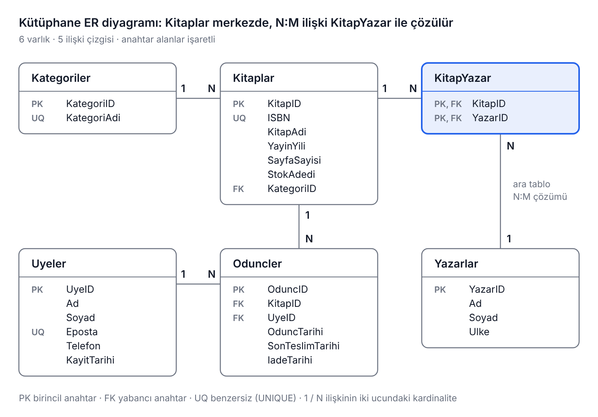

# MSSQL Öğreniyorum: Kütüphane Veritabanı Uygulaması

Bu repo, Microsoft SQL Server (MSSQL) ile veritabanı derslerinde kullanılan **kütüphane veritabanı** uygulamasının tüm SQL kodlarını içerir. Kodlar, [sevdanurgenc.com](https://www.sevdanurgenc.com) blogundaki **MSSQL Öğreniyorum Serisi** yazılarıyla birlikte ilerler.

## Veritabanı

Altı tablodan oluşan bir okul kütüphanesi senaryosu:

| Tablo | Açıklama |
| --- | --- |
| `Kategoriler` | Kitap kategorileri (Roman, Bilim, Tarih ...) |
| `Yazarlar` | Yazarlar ve ülkeleri |
| `Kitaplar` | Kitaplar; her kitap bir kategoriye bağlı (1:N) |
| `KitapYazar` | Kitap ile yazar arasındaki çoka-çok (N:M) ilişkiyi çözen ara tablo |
| `Uyeler` | Kütüphane üyeleri |
| `Oduncler` | Ödünç verme ve iade kayıtları |

## Dosyalar ve çalıştırma sırası

Önce **01** dosyalarını sırayla çalıştırın; diğer dosyalar bu veriye göre hazırlanmıştır ve her sorgunun altında beklenen sonuç yazılıdır.

| Dosya | Konu |
| --- | --- |
| [`sql/01_Kurulum.sql`](sql/01_Kurulum.sql) | Veritabanı, tablolar, kısıtlar (PK, FK, UNIQUE, CHECK, DEFAULT), temel INSERT/UPDATE/DELETE |
| [`sql/01_Veri_Ekleme.sql`](sql/01_Veri_Ekleme.sql) | Her tabloya en az 10 kayıt ekleyen örnek veri |
| [`sql/02_WHERE_Ornekleri.sql`](sql/02_WHERE_Ornekleri.sql) | Karşılaştırma operatörleri, BETWEEN, LIKE, IN, IS NULL, AND/OR |
| [`sql/03_Fonksiyonlar_GroupBy_Having.sql`](sql/03_Fonksiyonlar_GroupBy_Having.sql) | COUNT, SUM, AVG, UPPER, LEFT, ROUND, CEILING..., GROUP BY, HAVING |
| [`sql/04_JOIN_Turleri.sql`](sql/04_JOIN_Turleri.sql) | INNER, LEFT, RIGHT, FULL, CROSS ve SELF JOIN |
| [`sql/04_WHERE_ile_Birlestirme.sql`](sql/04_WHERE_ile_Birlestirme.sql) | JOIN'li sorguların WHERE ile yazılmış halleri |
| [`sql/05_Alt_Sorgular.sql`](sql/05_Alt_Sorgular.sql) | İç içe SELECT: IN, EXISTS, ilişkili alt sorgular |
| [`sql/06_VIEW.sql`](sql/06_VIEW.sql) | VIEW oluşturma, sorgulama, WITH CHECK OPTION |
| [`sql/07_CREATE_FUNCTION.sql`](sql/07_CREATE_FUNCTION.sql) | Skaler ve tablo döndüren kullanıcı tanımlı fonksiyonlar |
| [`sql/08_Stored_Procedure.sql`](sql/08_Stored_Procedure.sql) | Parametreli SP, LIKE, ALTER/DROP, OUTPUT, TRY...CATCH |
| [`sql/09_Trigger.sql`](sql/09_Trigger.sql) | AFTER / INSTEAD OF trigger, inserted/deleted, ROLLBACK |

## Gereksinimler

- SQL Server 2016 veya üzeri (Express sürümü yeterli). Betiklerde `DROP ... IF EXISTS` kullanıldığı için 2016 öncesi sürümlerde bu satırların düzenlenmesi gerekir.
- SQL Server Management Studio (SSMS) veya Azure Data Studio.

## Notlar

- Kitap bilgileri (ISBN, sayfa sayısı) ders için hazırlanmış örnek verilerdir.
- Veriyi değiştiren örnekler, diğer dosyalardaki beklenen sonuçlar bozulmasın diye kendi içinde geri alınır.
- `09_Trigger.sql` dosyasını çalıştırdıktan sonra, başka bir dosyaya geçmeden önce dosyanın sonundaki **Temizlik** bölümünü çalıştırın.
- Verileri ilk haline döndürmek için `01_Veri_Ekleme.sql` dosyasını yeniden çalıştırmanız yeterlidir.
